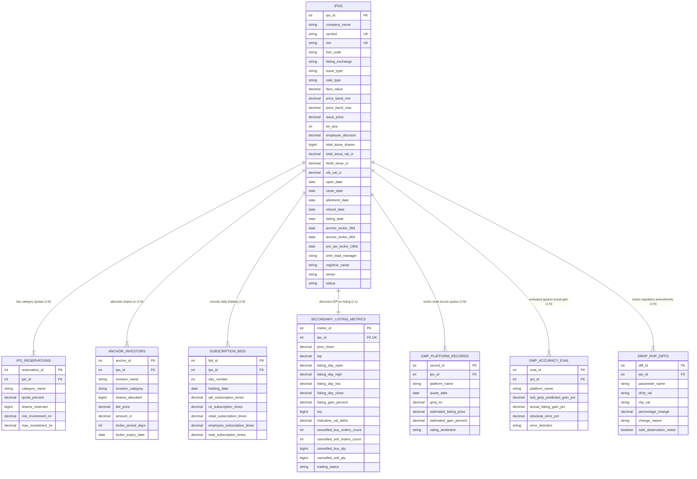

# Entity-Relationship (ER) Diagram & Relational Schema
**Project**: IPO Intelligence & Multi-Source GMP Analytics Platform  
**Evaluator**: Prof. Smitha GR, Faculty of AIML, RR Campus, PES University  
**Subject**: DBMS Mini Project Evaluation  

---

## 1. High-Level Architecture Overview
This project employs a **Polyglot Persistence (Hybrid RDBMS + NoSQL)** architecture:
- **Relational DBMS (MySQL / SQLite)**: Enforces ACID guarantees, entity integrity, foreign keys, and complex transactional relational queries for financial accounting data, bids, order cancellation metrics, and accuracy evaluations.
- **Document NoSQL (MongoDB)**: Stores dynamic, multi-modal documents including DRHP/RHP audio-visual MP4 video links, SEBI filing documents, YouTube research channel metadata, and dynamic peer comparison matrices.

---

## 2. ER Diagram (Mermaid Fenced Code Block)

---

## 3. Entity & Cardinality Descriptions

| Relationship | Cardinality | Explanation |
|---|---|---|
| `IPOS` &rarr; `IPO_RESERVATIONS` | 1 : N (One-to-Many) | An IPO has multiple investor quotas (QIB: 50%, NII: 15%, Retail: 35%, Employee). |
| `IPOS` &rarr; `ANCHOR_INVESTORS` | 1 : N (One-to-Many) | An IPO brings in dozens of institutional anchor institutions allocated with 30-day and 90-day lock-ins. |
| `IPOS` &rarr; `SUBSCRIPTION_BIDS` | 1 : N (One-to-Many) | An IPO bidding process lasts typically 3 trading days; each day records separate category bidding multiples. |
| `IPOS` &rarr; `SECONDARY_LISTING_METRICS` | 1 : 1 (One-to-One) | Once listed, an IPO has a single official listing session discovery record with Indicative Equilibrium Price (IEP) and order cancellations. |
| `IPOS` &rarr; `GMP_PLATFORM_RECORDS` | 1 : N (One-to-Many) | Multiple external grey market trackers (Chittorgarh, InvestorGain, IPOWatch) quote daily GMP premiums. |
| `IPOS` &rarr; `GMP_ACCURACY_EVAL` | 1 : N (One-to-Many) | Each tracking platform's final prediction is evaluated against the actual Day 1 closing listing gain. |
| `IPOS` &rarr; `DRHP_RHP_DIFFS` | 1 : N (One-to-Many) | Multiple parameters (fresh issue ratio, OFS value, issue size, valuation PE) change after SEBI's regulatory review. |

---

## 4. Normalization Status (1NF to BCNF)
- **1NF**: All table columns are atomic; no repeating groups.
- **2NF**: Every non-key attribute is fully functionally dependent on the entire primary key.
- **3NF**: There are no transitive dependencies (`X -> Y` where `Y` is non-prime and `X` is not a superkey).
- **BCNF**: For every functional dependency `X -> A`, `X` is a super key.
